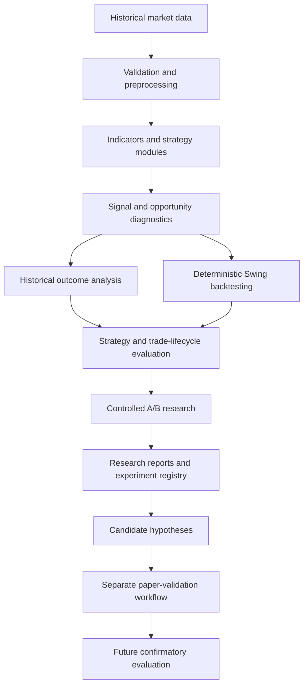

# Trust Me — Quantitative Trading Research Platform

**A personal Python project exploring how to build, evaluate, and improve rule-based trading strategies through reproducible data analysis.**

> **Project status:** Research and engineering in progress · **Last verified development activity:** October 20, 2026  
> **Repository type:** Public, documentation-only portfolio case study. The implementation and research artifacts are maintained separately and are not included here.

## Overview

Trust Me began as a strategy developed in **TradingView / Pine Script** and evolved into a modular **Python research platform**. The central question is not simply *“Can a strategy produce trading signals?”* but rather:

**Which signals and execution rules hold up under systematic historical testing, and what evidence would be needed before relying on them in new market conditions?**

To investigate this, I built a workflow that collects and validates market data, reconstructs strategy signals, diagnoses why opportunities are accepted or rejected, runs deterministic backtests, compares controlled strategy variants, and prepares a separate paper-validation process.

This is an **analytics and software engineering project**, not a commercial trading product or a proven profitable system.

## Project at a glance

| Area | Scope |
| --- | --- |
| Language | Python, with an earlier Pine Script strategy reference |
| Data | Historical OHLCV market data accessed through Yahoo Finance / `yfinance` |
| Research universe | 50 stocks in the frozen main research dataset |
| Historical coverage | Approximately five years of daily history, with shorter histories for newer listings |
| Strategy design | Four rule-based entry modules; long and short signal logic |
| Evaluation | Signal diagnostics, outcome analysis, Swing backtesting, trade lifecycle analysis, controlled A/B experiments |
| Validation direction | Frozen historical evidence, paper-scanner infrastructure, and prospective evidence collection |
| Core libraries | `pandas`, `numpy`, `yfinance`, `pytest`; supporting analysis and visualization libraries |

## Why I built it

A trading strategy can look convincing when judged by a few selected examples or a single headline metric. I wanted to approach that problem like a data analyst: build a measurable pipeline, make assumptions explicit, challenge hypotheses through controlled experiments, and preserve evidence even when a result is inconclusive.

The project also became an opportunity to practice data engineering, experiment design, automation, testing, and the distinction between **historical observations** and **information available at decision time**.

## How the system works

### 1. Data processing and signal generation

The platform downloads and normalizes **open, high, low, close, and volume (OHLCV)** data, validates its structure, and calculates market context and technical indicators. Features include trend, momentum, volatility, volume, and price-structure measurements.

Four entry modules are evaluated:

| Module | Research idea |
| --- | --- |
| **Pullback** | Investigate entries after a temporary move against a broader trend |
| **Breakout** | Examine price moves beyond established levels, with supporting context |
| **Squeeze** | Study volatility contraction followed by expansion |
| **Mean Reversion** | Explore recovery after an extended price or momentum movement |

The modules may overlap. A signal can meet multiple conditions, so results are also studied in **pure-module cohorts** to avoid confusing individual module effects with combinations.

### 2. Diagnostics and historical outcomes

Instead of recording only a final buy/sell signal, the system analyzes the path to that decision:

- Which entry conditions passed or failed?
- Which opportunities were close to becoming signals?
- How did signals and blocked opportunities perform afterward?
- Do apparent patterns persist across symbols, years, and market contexts?

A retrospective outcome layer calculates forward returns and favorable/adverse price excursions. Those future-dependent outcomes are **kept separate from decision-time features** to reduce the risk of look-ahead bias.

### 3. Deterministic backtesting and trade analysis

The research backtester simulates a **one-position-at-a-time Swing strategy** with explicit timing assumptions, such as signals evaluated at a completed bar and entries at the following bar's open.

Trade evaluation covers metrics including **win rate, profit factor, expectancy, average/median returns, holding periods, maximum favorable excursion (MFE), and maximum adverse excursion (MAE)**.

The system also examines how exits influence trade outcomes: trailing-stop behavior, exit timing, unrealized favorable movements, and how a changed exit can affect the availability of later trades.

**Important limitation:** Historical backtests do not establish real-world profitability. The original backtest does not provide a full portfolio simulation, realistic execution-cost calibration, position sizing, or complete risk-adjusted performance measurement.

### 4. Controlled A/B experiments

A major part of the project is comparing strategy variants **against the same historical input**, typically changing one parameter or execution rule at a time.

Examples of research questions include:

- How does a dynamically updated volatility stop compare with a stop based on volatility at entry?
- What changes when a trend-based exit is enabled or disabled?
- Do tighter or wider stop distances improve a module's outcomes consistently?
- Does an apparent improvement survive paired-signal analysis rather than only an aggregate average?

Results are inspected at trade, symbol, and year level. The workflow records experiment settings and exports structured research artifacts so that findings can be reviewed rather than recreated from memory.

## Selected findings and lessons

The historical research produced different levels of evidence across modules:

| Research cohort | Outcome of the historical investigation |
| --- | --- |
| **Mean Reversion** | A **provisional** exit-policy candidate was identified; independent confirmation is still required. |
| **Pure Pullback** | A **research baseline** was established, with remaining concerns about stability and sensitivity to extreme trades. |
| **Pure Breakout** | **Inconclusive**: improvements in some aggregate metrics did not translate into a robust, coherent candidate across the predefined comparisons. |
| **Pure Squeeze** | **Inconclusive**: limited samples and sensitivity to individual periods or outcomes prevented a confident selection. |

Further entry-quality, win-rate, and trade-lifecycle investigations were carried out in separate, staged research workflows. These studies investigate why trades fail, when favorable price movement occurs, and whether proposed changes preserve strong trades as well as avoiding weak ones.

**My main takeaway:** An appealing backtest statistic is a starting hypothesis, not a final answer. Paired comparisons, sample size, temporal stability, extreme observations, and the distinction between exploration and confirmation all matter.

## Paper scanner and prospective validation

The next engineering phase moves beyond repeatedly testing the same historical dataset.

I implemented a **paper-scanner research architecture** designed to freeze a candidate protocol and record when new market observations actually become available. It distinguishes historical data, later-observed data, and genuinely prospective paper observations rather than labeling a historical replay as live evidence.

The work includes:

- Data-availability rules and explicit observation timestamps.
- Frozen research configurations, source identities, and integrity checks.
- Separate baseline, reference, and experimental comparison streams.
- An initial scanner design and a more compact event-based storage version.
- Checkpointing, recovery paths, typed data exports, and offline regression tests.

### Current scanner status — October 20, 2026

The scanner's **offline infrastructure and tests were implemented**, but **prospective performance validation had not started successfully**. The first manual real-data attempt in the newer storage version stopped during data verification before a complete run was published. A provider-metadata normalization issue was corrected afterward, which requires a newly reviewed/frozen protocol before further valid collection.

Therefore, this project **does not yet have confirmed prospective trading results**, and the scanner must not be presented as a continuously operating or production-ready live trading service.

## Research principles

The project follows several principles that matter well beyond trading:

1. **Reproducibility:** Preserve research configurations, datasets, reports, and experiment identities.
2. **Causal timing:** Keep future outcomes out of inputs available when a decision would have been made.
3. **Controlled comparisons:** Isolate rule changes and compare matching signals where possible.
4. **Robustness over headlines:** Inspect distributions, medians, outliers, symbols, and years—not only averages.
5. **Transparent uncertainty:** Record inconclusive findings and operational failures rather than retroactively treating them as success.
6. **Separation of concerns:** Distinguish data preparation, signal generation, historical evaluation, and prospective evidence collection.

## Technical skills demonstrated

| Discipline | Examples from the project |
| --- | --- |
| **Python development** | Modular research pipeline, data transformations, reusable analytical functions |
| **Data engineering** | Market-data ingestion, OHLCV validation, time-aware transformations, structured CSV artifacts |
| **Data analysis / BI** | Diagnostic summaries, cohort comparisons, performance metrics, interpretive research reports |
| **Experiment design** | Controlled A/B testing, paired observations, frozen configurations and research registries |
| **Software testing** | `pytest`, deterministic regression tests, reproducibility and recovery checks |
| **Quantitative research** | Backtesting assumptions, risk/return measurements, trade lifecycle and temporal evaluation |
| **Systems thinking** | Modular architecture, data contracts, provenance, incremental research milestones |

## Development timeline

| Phase | Milestone |
| --- | --- |
| **Foundation** | Strategy created in Pine Script and translated into a Python research core |
| **Historical research** | Signal diagnostics, historical outcomes, deterministic Swing backtesting and A/B framework |
| **September 2026** | Module-specific exit studies, entry-quality research, win-rate investigations and trade-lifecycle experiments |
| **October 2026** | Prospective validation architecture, paper-scanner implementation, compact event storage and recovery/testing work |
| **Next** | Establish a fresh valid collection protocol, gather genuinely new observations, and evaluate candidates out of sample |

## Roadmap

- [x] Build Python-based strategy calculations and diagnostics.
- [x] Implement a deterministic historical Swing backtester.
- [x] Create repeatable A/B experiments and research artifacts.
- [x] Complete staged exit, entry, win-rate, and lifecycle research.
- [x] Implement and offline-test paper-scanner / prospective validation infrastructure.
- [ ] Establish a fresh validated scanner protocol after the October 2026 interruption.
- [ ] Accumulate genuinely prospective observations and assess stability.
- [ ] Perform independent walk-forward / out-of-sample confirmation.
- [ ] Consider explainable **TAKE / SKIP decision support** only after sufficient evidence exists.
- [ ] Evaluate predictive modelling / machine learning only with clear targets, time-based data splits, leakage controls, and meaningful baselines.

> A checked item means the research or engineering milestone was implemented; it **does not** mean a trading advantage has been proven.

## About this repository

This is the **public-facing case study** for Trust Me. It is intentionally limited to project context, architecture, methods, selected findings, progress, and lessons learned. The codebase, exact strategy implementation, raw datasets, and detailed research artifacts are **not distributed in this repository**.

If you are interested in the **engineering or analytics approach**, this page summarizes the problem, the process, and the results without exposing the full implementation.

---

*Research and educational project only. Not investment advice. Historical analysis, simulated trades, and paper workflows do not guarantee future results.*
